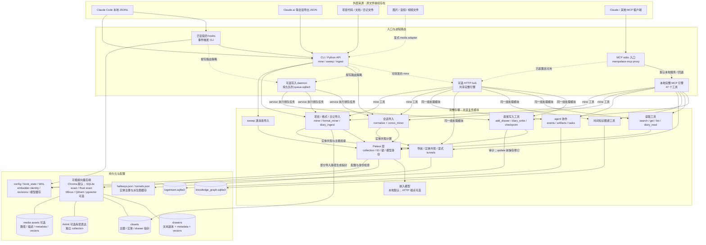
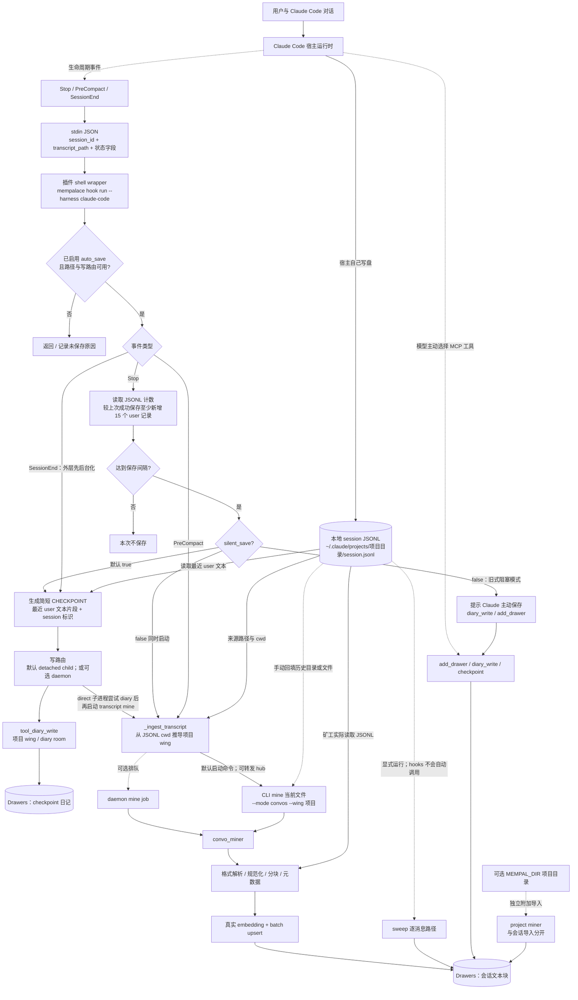
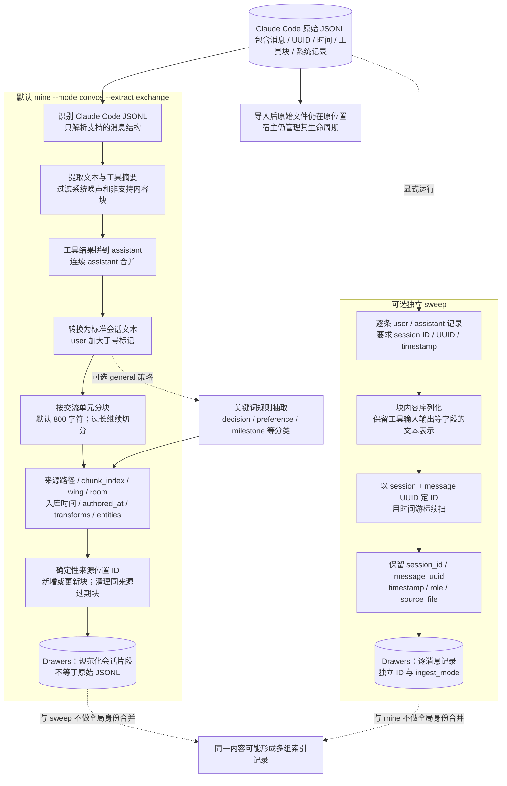
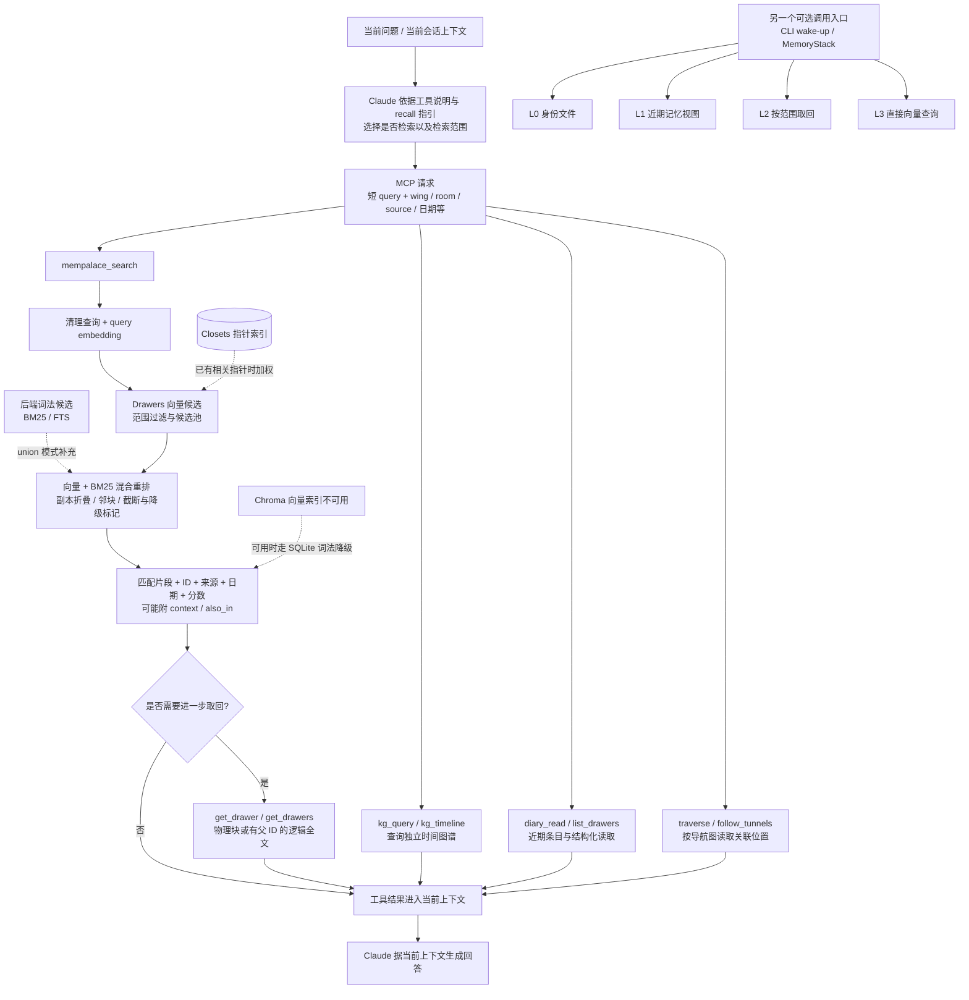

# MemPalace 完整架构与 Claude 数据流

核查日期：2026-10-22。固定上游提交：[`f41e8e75ddaadf5588d5127715fa531d79eadb45`](https://github.com/MemPalace/mempalace/commit/f41e8e75ddaadf5588d5127715fa531d79eadb45)，源码版本字段 `3.12.0`。下面描述这个提交的实际实现，包含可选模块，不把路线图当成已实现功能。本次没有安装 Claude 插件或读取用户真实 Claude 历史。

图中实线表示主要数据/调用路径，虚线表示条件路径、控制触发或辅助信号。可选项需要显式配置，不表示默认全部运行。`hook`、`mine`、`checkpoint` 与 `sweep` 是不同入口；不能把一个入口的保真、去重或返回 ID 语义推广到其他入口。

## 图 1：全系统组件与物理存储



图 1 补充边界：

- “47 工具”是当前完整 MCP 工具面，不是 47 个独立服务；CLI、hub 和 daemon 复用 Python 模块。
- `mempalace-light-mcp` 另提供三个聚合工具，仍委托完整工具实现；它是接口门面，不是另一套存储引擎。本图以完整工具面为主。
- `mempalace serve` 的 HTTP hub 与 queued-write daemon 是两个不同组件。hub 共享服务/读写句柄，daemon 保存并执行写入作业；不能画成同一进程。
- 默认本地写路由为 `direct`；可配置 `prefer` / `require` daemon。hooks 不会为一次保存自动冷启动 daemon；require 且不可用时拒绝本次写入，不能画成一定回退成功。
- 默认 `chroma.sqlite3` 保存文本与元数据，UUID 子目录中的 HNSW 文件保存向量索引。其他后端具有自己的物理格式；`sqlite_exact` 与 `rust_exact` 可共用 `sqlite_exact.sqlite3`。
- collections 为 `mempalace_drawers`、`mempalace_closets`、`mempalace_aaak`，媒体另有 `mempalace_assets`。媒体路径显式启用且需要相应 EmbeddingGemma 2 能力；普通 Claude transcript parser 不会自动把图片转交该媒体索引。
- `add_drawer`、自动 diary、默认会话 mine 都不会顺便生成全部 closet 或时间图谱事实。默认会话 mine 额外尝试计算 hallways；这是实体共现连接，不等于 KG 的事实抽取。

## 图 2：Claude Code 的数据如何进入



### 两种 Claude 产品入口要分清

| 来源 | 实际入口 | 不应画成 |
| --- | --- | --- |
| Claude Code 本地会话 | 宿主 JSONL → 已配置 hook 或手动 CLI → convo_miner | MemPalace 在云端旁听所有 Claude 请求 |
| Claude Code 的 MCP 调用 | 模型选择工具并传入显式 arguments → MCP server | MCP server 自动获得完整上下文 |
| Claude.ai / 普通聊天产品导出 | 用户取得 JSON → CLI convos → Claude.ai schema parser | 安装 MCP 后自动同步账号全部历史 |
| 任意 MCP 宿主，包括普通 Claude Desktop 聊天 | 宿主连接 server 后，模型可主动写入工具参数 | 自动具备 Claude Code 的本地 hooks / JSONL 采集 |

### 插件与旧 shell 配置

该提交的 `.claude-plugin/hooks/hooks.json` 只注册 `Stop`、`PreCompact`、`SessionEnd`。根目录旧式 `hooks/mempal_save_hook.sh`、`mempal_precompact_hook.sh` 也已委托同一个 Python hook runner，不能当成另一套旧算法。若两套注册同时安装，可能重复触发，不能在图中默认并行安装。

虽然 Python 有 `hook_session_start`，该 Claude 插件未注册 SessionStart；该处理函数也只是状态/路由准备并返回空响应，不会自动注入 L0–L3 全部记忆。插件里的 recall skill 是行为指引，实际搜索仍需要模型调用工具。

### 自动 checkpoint 与完整 transcript 是两份不同的产物

默认 Stop 保存的 checkpoint 不调用 LLM 总结。源码读取最近 30 条有效 user 文本，每条先截取 200 字符，再把最后 10 条各取 80 字符拼成 `CHECKPOINT:日期|session:...|msgs:...|recent:...`。它没有保留 assistant 回复和工具结果，正文可能跨多个物理 chunk；“一次 diary 调用”不能永远等同于一个物理 drawer。

direct 模式在 detached child 中尝试 diary 写入，再启动 transcript mine 与 MEMPAL_DIR 导入；若排队失败或没有有效 user 片段，调用方可直接继续尝试 transcript mine。daemon 模式按 job 排队处理，不能把子进程顺序套用到所有配置。Stop 的保存标记与 diary 成功相关，不等于确认 transcript 全部索引完成。

**PreCompact 的实现存在必须标出的等待边界：**它调用 `_ingest_transcript`，direct 路径用 `_spawn_mine` 后台启动，daemon 路径 `wait=False`；随后 `_mine_sync` 等待的是可选 MEMPAL_DIR 的项目导入。函数结束返回 `{}`，没有逐条确认 transcript 入库后再放行的保证。不要仅凭函数 docstring 的“synchronously”把图画成同步完成。

SessionEnd 的 shell wrapper 先捕获 stdin，再后台运行 Python runner并立即返回；它是干净退出时的最后一次尝试，不能覆盖断电或强杀。hook 回执、checkpoint 回执、transcript mine 完成是不同状态。

## 图 3：同一份 Claude JSONL 的两条解析路径



默认路径的数据保留情况：

| JSONL 内容 | 默认 normalize / mine 处理 | sweep 处理 |
| --- | --- | --- |
| user / assistant 正文 | 提取正文、去边缘空白与噪声，转成标准文本；可合并轮次 | 每条消息加 role 前缀后保存 |
| message UUID、每条消息时间 | 不作为逐消息结构保留；主要定位是 source_file + chunk_index；authored_at 可取整文件最新消息时间 | 保存 message_uuid、timestamp、session_id、role |
| thinking / image / document 等 block | `_extract_content` 不纳入正文，并记录转换痕迹 | parser 将支持记录中的块序列化为文本；不是媒体资产索引，也不是原 JSON 字节备份 |
| `tool_use` | 转成工具一行摘要；Bash/未知工具输入可能截断；Edit/Write 主要保留路径 | 序列化记录中的工具输入 |
| Read / Edit / Write 的 tool_result | 省略返回正文 | 保留结果的序列化文本 |
| Bash 的 tool_result | 超过 40 行时，只保留前 20 行和后 20 行，并插入省略标记 | 不走这一裁剪逻辑 |
| Grep / Glob 的 tool_result | 超过 20 行时截断 | 不走这一裁剪逻辑 |
| 未知工具结果 | 当前按 2048 字符上限裁剪，常量名虽写 bytes，代码实际按字符串切片 | 序列化记录中的结果 |
| system / progress / summary 等非会话记录 | 通常不进入会话正文；无法识别的格式可能走其他 parser 或文本 fallback | 只取 type 为 user/assistant 的有效记录 |
| 子 agent JSONL | `scan_convos` 目录扫描默认跳过 `subagents/`；显式 include_subagents 可启用 | 独立递归扫描逻辑，不能套用 mine 的默认排除假设 |

两点不能混淆：

1. 默认 `convo_miner` 的来源位置型 chunks 没有逐消息 `parent_drawer_id`；按一个命中 ID 的 `get_drawer` 通常只取得那一块，不会自动返回整个 session。显式 `add_drawer` 或 diary 写入的大正文逻辑组，才有父 ID 拼接语义。
2. 默认会话 chunker 与 project miner 不同：当前会话 exchange 路径会尽量合并短单元并保存非空白内容，不能把项目 `min_chunk_size=50` 的短片段跳过规则直接套用给它。

默认 hooks 不调用 sweep；sweep 是额外手动或外部调度动作。默认会话 mine 也不自动生成全部 closet；项目 miner 和 diary 文件导入等路径可以生成。上图的 general extraction 是规则/关键词方法，不需要 LLM；选择它会改变入库粒度与覆盖范围。

## 图 4：召回如何回到 Claude，以及辅助模块



这里的“进入上下文”是 MCP 宿主的行为；MemPalace 不修改 Claude 模型权重。`wake-up` / L0–L3 也不是每次 MCP search 必经的步骤。其 L3 直接查询与 MCP 的混合搜索不是同一条完整算法链。

默认 search 需要 query embedding 和检索，不调用 LLM reranker；基准里的 LLM rerank、可选 closet LLM 再生成、实体 LLM 精修属于各自显式入口，不能画成每次写入/检索自动经过它们。

### 完整产品的附属能力与默认关系

| 模块 | 作用与数据 | 与 Claude 默认采集的关系 |
| --- | --- | --- |
| `config.py` / `paths.py` | 配置、palace 选择、模型和路由；config 与数据路径可独立 | hooks、CLI、server 共同读取；不意味着全部状态位于一个 palace 目录 |
| `embedding.py` / `embeddinggemma2.py` | 本地 minilm / embeddinggemma；可选 EmbeddingGemma 2 与 HTTP embedding | 默认无需远程 embedding；具体模型必须由实际配置确定 |
| `palace/` / backend contract | collection、确定性 ID、单写者、模型身份、来源去重和完成状态 | 各写入路径共享底层，但去重身份不相同 |
| knowledge graph | `knowledge_graph.sqlite3` 中的实体关系、有效期、supersede | 需显式 KG 写入或相应专门逻辑；普通 transcript mine 不等于自动抽取事实 |
| hallways / tunnels | `hallways.json`、`tunnels.json`；共现边、显式跨 wing 连接及派生缓存 | 部分 mine 后计算共现；不是另一份完整会话库 |
| dynamics | 连接强度和衰减的纯计算函数 | 当前关联模块主要初始化这些字段，不能声称已接通自动强化/遗忘循环 |
| AAAK / compress | `mempalace_aaak` 中可选有损表达 | 不是默认会话存储格式，也不是默认 search 的原文来源 |
| logstream | `logstream.sqlite3` 中的不可变任务事件、回复、artifact、patch | agent 协作独立入口，不是 Claude transcript 自动镜像 |
| mesh / logsync | 配置 peers 后，经 HTTPS bearer transport 拉取 logstream events/artifacts | 当前 shipping 同步边界是协作日志；不能把它画成自动复制所有 drawers、向量和 KG |
| repair / rebuild / migrate | 维护、恢复、索引重建和模型迁移 | 显式维护动作；索引缓存重连不等于完整重建 |
| update / delete / sync / revisions | 修改或删除 drawer、来源清理；update 前保留修订 | 不会顺便编辑 Claude 原始 JSONL；默认会话重导入也不是永久保留各历史版本的证明 |
| export / backups | 人可读导出、维护过程的备份与恢复材料 | Markdown export 不包含全部向量、KG、日志、修订和配置 |
| audit / topology repair | 检查 wing/room 组织及噪声，辅助整理 | 用户主动调用，不是每条消息的必经处理 |

## 验证：确实沿 Claude 数据链走了一遍

本次使用固定源码，合成 10 条 Claude Code JSONL 记录，包括 user/assistant、thinking、image、Read 与 60 行 Bash 结果。直接调用该版本 `mine_convos(..., wing='claude_flow_probe')`，使用真实 Chroma 和已有 minilm CPU 缓存；没有 embedding 替身。

- 成功生成 3 个会话 drawer，原始 JSONL 的 SHA-256 未变。
- 已存正文不含 thinking、image、Read 返回正文和 Bash 第 30 行；包含 Bash 首尾行。
- 默认 mine 的 metadata 没有逐消息 session_id/message_uuid，也没有父 session 的 parent_drawer_id；来源和 chunk_index 等字段存在。
- 同一输入经 sweep parser 的展开结果保留了 thinking、Read 输出与 Bash 第 30 行。这里验证的是其 parser 保留能力，未额外执行 sweep 写库。
- `_extract_recent_messages` 返回三条真实 user 文本，没有把两条纯工具结果当成 checkpoint 正文。

结果保存在 [Claude flow validation](mempalace-claude-flow-validation-2026-10-22.json)。原始合成输入、规范化输出和库中条目在临时目录 `C:\Users\Administrator\AppData\Local\Temp\mysoul-claude-flow-21uk01ot`，可能被系统清理。

另外运行了当前源码的相关上游测试：

```text
python -m pytest tests/test_normalize.py tests/test_claude_plugin_hook_config.py tests/test_hook_write_routing.py -q --disable-warnings
194 passed in 0.76s
```

该测试结果验证所选 parser/hook 配置/路由逻辑；没有实机运行 Claude Code 生命周期事件，不能冒充安装和自动采集验收。

## 源码定位

以下链接固定到同一提交，方便后续逐条讨论图中的箭头：

| 图中位置 | 实际源码 |
| --- | --- |
| Claude 三类事件注册 | [hooks.json](https://github.com/MemPalace/mempalace/blob/f41e8e75ddaadf5588d5127715fa531d79eadb45/.claude-plugin/hooks/hooks.json) |
| SessionEnd 后台化 wrapper | [mempal-session-end-hook.sh](https://github.com/MemPalace/mempalace/blob/f41e8e75ddaadf5588d5127715fa531d79eadb45/.claude-plugin/hooks/mempal-session-end-hook.sh) |
| Stop / PreCompact / SessionEnd 实际处理 | [hooks_cli.py](https://github.com/MemPalace/mempalace/blob/f41e8e75ddaadf5588d5127715fa531d79eadb45/mempalace/hooks_cli.py#L1482) |
| checkpoint 片段生成和后台任务 | [hooks_cli.py](https://github.com/MemPalace/mempalace/blob/f41e8e75ddaadf5588d5127715fa531d79eadb45/mempalace/hooks_cli.py#L1098) |
| transcript 实际导入命令 | [hooks_cli.py](https://github.com/MemPalace/mempalace/blob/f41e8e75ddaadf5588d5127715fa531d79eadb45/mempalace/hooks_cli.py#L1228) |
| 项目 wing 推导与旧路径 fallback | [hooks_cli.py](https://github.com/MemPalace/mempalace/blob/f41e8e75ddaadf5588d5127715fa531d79eadb45/mempalace/hooks_cli.py#L1398) |
| CLI mine 的 daemon / hub / 本地选择 | [cmd_mine.py](https://github.com/MemPalace/mempalace/blob/f41e8e75ddaadf5588d5127715fa531d79eadb45/mempalace/cli/cmd_mine.py#L9) |
| hook direct/prefer/require 策略 | [write_routing.py](https://github.com/MemPalace/mempalace/blob/f41e8e75ddaadf5588d5127715fa531d79eadb45/mempalace/write_routing.py) |
| 独立持久写入队列 | [daemon.py](https://github.com/MemPalace/mempalace/blob/f41e8e75ddaadf5588d5127715fa531d79eadb45/mempalace/daemon.py) |
| Claude Code 规范化 | [normalize.py](https://github.com/MemPalace/mempalace/blob/f41e8e75ddaadf5588d5127715fa531d79eadb45/mempalace/normalize.py#L324) |
| Claude.ai 导出解析 | [normalize.py](https://github.com/MemPalace/mempalace/blob/f41e8e75ddaadf5588d5127715fa531d79eadb45/mempalace/normalize.py#L668) |
| 工具输入/输出裁剪与省略 | [normalize.py](https://github.com/MemPalace/mempalace/blob/f41e8e75ddaadf5588d5127715fa531d79eadb45/mempalace/normalize.py#L979) |
| 交流分块、来源块 ID、写入元数据 | [convo_miner.py](https://github.com/MemPalace/mempalace/blob/f41e8e75ddaadf5588d5127715fa531d79eadb45/mempalace/convo_miner.py#L267) |
| 源文件新块写入和旧块清理 | [palace/writes.py](https://github.com/MemPalace/mempalace/blob/f41e8e75ddaadf5588d5127715fa531d79eadb45/mempalace/palace/writes.py#L150) |
| sweep 逐消息 parser 与写入 | [sweeper.py](https://github.com/MemPalace/mempalace/blob/f41e8e75ddaadf5588d5127715fa531d79eadb45/mempalace/sweeper.py#L91) |
| 真正的 diary 写入 | [tools_diary.py](https://github.com/MemPalace/mempalace/blob/f41e8e75ddaadf5588d5127715fa531d79eadb45/mempalace/mcp_server/tools_diary.py#L10) |
| MCP 代理与本地完整引擎 | [mcp_proxy.py](https://github.com/MemPalace/mempalace/blob/f41e8e75ddaadf5588d5127715fa531d79eadb45/mempalace/mcp_proxy.py) |
| 轻量工具门面 | [mcp_light_server.py](https://github.com/MemPalace/mempalace/blob/f41e8e75ddaadf5588d5127715fa531d79eadb45/mempalace/mcp_light_server.py) |
| search 工具入口 | [tools_read.py](https://github.com/MemPalace/mempalace/blob/f41e8e75ddaadf5588d5127715fa531d79eadb45/mempalace/mcp_server/tools_read.py#L608) |
| 混合搜索主体 | [searcher/query.py](https://github.com/MemPalace/mempalace/blob/f41e8e75ddaadf5588d5127715fa531d79eadb45/mempalace/searcher/query.py#L189) |
| 向量后端契约 | [backends/base.py](https://github.com/MemPalace/mempalace/blob/f41e8e75ddaadf5588d5127715fa531d79eadb45/mempalace/backends/base.py) |
| 原文 / closet / AAAK / asset collections | [palace/collection.py](https://github.com/MemPalace/mempalace/blob/f41e8e75ddaadf5588d5127715fa531d79eadb45/mempalace/palace/collection.py) |
| 时间知识图谱 | [knowledge_graph.py](https://github.com/MemPalace/mempalace/blob/f41e8e75ddaadf5588d5127715fa531d79eadb45/mempalace/knowledge_graph.py) |
| L0–L3 另一套读取入口 | [layers.py](https://github.com/MemPalace/mempalace/blob/f41e8e75ddaadf5588d5127715fa531d79eadb45/mempalace/layers.py) |
| logstream 跨副本同步边界 | [logsync.py](https://github.com/MemPalace/mempalace/blob/f41e8e75ddaadf5588d5127715fa531d79eadb45/mempalace/logsync.py)、[HTTP /sync 端点](https://github.com/MemPalace/mempalace/blob/f41e8e75ddaadf5588d5127715fa531d79eadb45/mempalace/mcp_server/http.py#L684) |
| Claude Code hook stdin 与事件定义 | [Claude 官方 Hooks reference](https://code.claude.com/docs/en/hooks)；具体 MemPalace 行为仍以上述代码为准 |

这四张图共同覆盖数据来源、触发、路由、转换、持久化、召回与辅助能力。图里最需要保留的边界是：**Claude 原始 session、MemPalace 规范化会话 drawer、自动 checkpoint、主动 MCP 保存、可选 sweep 是不同产物，不能合称“同一份原文”。**
