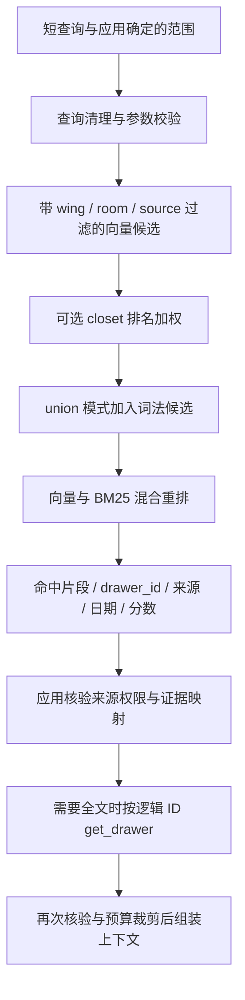

# MemPalace 存储、写入与召回调研

调研日期：2026-10-22。用途：供 mysoul 整体计划与 T04 记忆适配参考。本文件记录调查结果和建议，不修改已接受的架构决策，不代表 mysoul 集成已完成。

## 1. 结论

MemPalace 可以承担 mysoul 的持久原文召回层：默认把正文、元数据和向量交给本地 Chroma，另有独立的 SQLite 知识图谱。MCP 的写入、搜索、按 ID 取回接口真实存在，长文支持逻辑 drawer 与物理 chunk 的映射。

但它不替应用管理完整的事件身份、访问权限、事务队列或权威 Recap。接入时最需要处理的是：**相同文本的不同事件会合并；权限范围需要应用强制；默认嵌入模型偏英语；检索命中片段不等于完整证据；应用自己的 outbox 不能由上游 WAL 替代。**

已完成一次真实 Chroma + 缓存 ONNX 模型的 stdio MCP 实验，以及 171 项上游相关测试。多语嵌入模型的中文质量、规模性能、Python 3.12 环境兼容性仍未验证，不能据此关闭项目的完整 T04-live 门禁。

## 2. 调研版本与证据边界

官方仓库为 [MemPalace/mempalace](https://github.com/MemPalace/mempalace)。本次拉取、阅读并运行：

| 对象 | 本次观察 |
| --- | --- |
| 实测源码 | `develop` 的固定提交 `f41e8e75ddaadf5588d5127715fa531d79eadb45` |
| 提交时间 | 2026-10-20，源码包版本字段为 `3.12.0` |
| 同时观察的 main | `602d796c699cabba2971982cd9dccbbf46abfe79`，包版本字段 `3.11.0`；未对 main 跑同一套验证 |
| 真实实验环境 | Windows，Python 3.13.12，Chroma 1.5.8，ONNX Runtime 1.23.2，NumPy 2.4.4 |
| 真实实验模型 | 已有缓存的 `minilm`，CPU，无替身 embedding，无新增模型下载 |
| 探测到的 MCP 工具数 | 47 |

这里的版本字段不等于已经选择了 mysoul 的生产依赖，也不等于对应 PyPI 发布物已测。`develop` 和 `main` 的相关文件存在明显差异，落地时必须固定实际验证的发布物或提交。以下实现细节均以上述固定提交为准。

依据：[develop 提交](https://github.com/MemPalace/mempalace/commit/f41e8e75ddaadf5588d5127715fa531d79eadb45)、[main 提交](https://github.com/MemPalace/mempalace/commit/602d796c699cabba2971982cd9dccbbf46abfe79)、[依赖和入口定义](https://github.com/MemPalace/mempalace/blob/f41e8e75ddaadf5588d5127715fa531d79eadb45/pyproject.toml)。

## 3. 存储到底在哪里

### 3.1 逻辑结构

`palace → wing → room → drawer` 是正文的组织与筛选结构。wing 通常是人物、项目或大类；room 可以是主题、日期或会话，具体取决于写入路径。它们主要表现为记录元数据，不意味着每个 wing/room 都对应一个物理目录或独立权限域。

| 层/数据 | 实际作用 | 存储与边界 |
| --- | --- | --- |
| Drawers | 原文或原文片段 | 默认 collection 为 `mempalace_drawers`；正文、metadata、embedding 由后端保存 |
| Closets | 紧凑主题/实体/原文位置指针 | `mempalace_closets`；项目 miner 可生成；搜索用它加权，不靠它决定原文是否有资格入选 |
| AAAK | 可选、有损的缩写表达 | 与原文分离的 collection；显式 compress 使用；默认搜索不把它当原文 |
| Knowledge graph | 实体关系与有效时间 | palace 内的 `knowledge_graph.sqlite3`；独立查询、增加、失效、替换接口 |
| Drawer revisions | drawer 更新前的旧正文与元数据 | palace 内的 `drawer_revisions.jsonl`；更新前先追加并 fsync；删除 drawer 会清理对应修订 |
| Write log | 写入意图和结果的审计 | config 目录下 `wal/write_log.jsonl`；正文被脱敏，日志错误不阻止业务写入 |
| Logstream | 多 agent 事件与 artifact | 独立的 `logstream.sqlite3`；不是本项目记忆接入所必需 |

依据：[collection 定义](https://github.com/MemPalace/mempalace/blob/f41e8e75ddaadf5588d5127715fa531d79eadb45/mempalace/palace/collection.py#L513)、[图谱表结构](https://github.com/MemPalace/mempalace/blob/f41e8e75ddaadf5588d5127715fa531d79eadb45/mempalace/knowledge_graph.py#L341)、[修订日志](https://github.com/MemPalace/mempalace/blob/f41e8e75ddaadf5588d5127715fa531d79eadb45/mempalace/revisions.py#L28)、[审计日志](https://github.com/MemPalace/mempalace/blob/f41e8e75ddaadf5588d5127715fa531d79eadb45/mempalace/wal.py#L73)。

### 3.2 物理文件与后端

默认 Chroma 的 `chroma.sqlite3` 保存持久数据，向量索引还有 UUID 子目录中的 HNSW 文件；本次实测确实生成了 SQLite、`data_level0.bin`、`header.bin`、`length.bin`、`link_lists.bin`，以及记录嵌入模型身份的 `mempalace_embedder.json`。正文不要求回读外部源文件才能取出。

目前上游同时提供 `chroma`、`sqlite_exact`、`rust_exact`、`milvus`、`qdrant`、`pgvector`。其中 `sqlite_exact` 用 SQLite 存 float32 向量并做 NumPy 精确搜索；`rust_exact` 可复用其数据库。**完整官方引擎不等于只能用 Chroma**，但切换后端不应直接混用旧目录，本次也没有测量其他后端，不能把它们当作已经验证的替代方案。

配置目录和 palace 数据目录是两件事。可显式设置 `MEMPALACE_CONFIG_DIR` 和 `--palace` / `MEMPALACE_PALACE_PATH`。只设置 palace 不会自动收拢所有 config、WAL、模型缓存或旧式用户状态。`tunnels.json`、`hallways.json` 按当前配置取 palace 的父目录；若设计多个 palace，应给它们各自的父目录，避免旁路状态混在一起。

依据：[后端契约](https://github.com/MemPalace/mempalace/blob/f41e8e75ddaadf5588d5127715fa531d79eadb45/mempalace/backends/base.py)、[SQLite 精确后端](https://github.com/MemPalace/mempalace/blob/f41e8e75ddaadf5588d5127715fa531d79eadb45/mempalace/backends/sqlite_exact.py)、[路径规则](https://github.com/MemPalace/mempalace/blob/f41e8e75ddaadf5588d5127715fa531d79eadb45/mempalace/paths.py)、[配置路径](https://github.com/MemPalace/mempalace/blob/f41e8e75ddaadf5588d5127715fa531d79eadb45/mempalace/config.py#L706)。

## 4. 数据如何写入

### 4.1 应用直接写入：`mempalace_add_drawer`

实际公开参数是：

```json
{
  "wing": "owner_private",
  "room": "preferences",
  "content": "用户原话：我喜欢喝茉莉花茶，不喜欢喝咖啡。",
  "source_file": "<本地证据来源>",
  "added_by": "mysoul"
}
```

`wing`、`room`、`content` 必填。没有通用 `metadata`、自定义 `drawer_id`、`evidence_id`、事件发生时间或 ACL 参数。应用不能假设这些字段能透传进上游。

实现顺序为：校验 → 生成确定性 ID → 写审计意图 → 检查 ID 是否已存在 → 计算向量并 upsert → 读回 ID 确认可见 → 返回结果并记录审计结果。

- ID 的实际代码采用各部分长度前缀编码后 SHA-256 截取 24 位十六进制，并附带 wing/room 前缀。输入是 **wing、room、全文**，不含 `source_file` 或 `added_by`。不要照源码里仍提到分隔符的旧注释自行重实现 ID。
- 相同 wing/room/正文再次写入返回 `success: true, reason: already_exists`，并且不会补写第二个来源或更新时间。本次实际复现。
- 正文最大 100,000 个字符；空白正文和 NUL 被拒绝。该路径不是任意字节归档 API。
- 默认 `chunk_size = 800`，单位是 Python 字符数，不是 token。较长正文按字符连续切分，无重叠；分块 ID 为 `<logical_id>_chunk_000000` 等，并写入 `parent_drawer_id`、`chunk_index`。
- 返回的 `drawer_id` 是逻辑组 ID，分块时另外返回 `chunk_ids`。按逻辑 ID 获取会排序并直接拼接所有块。小正文是一行；大正文通常没有单独的逻辑父行。
- 写入使用一次批量 upsert，并探测最后一块确认可读。它不能提供 mysoul SQLite 与 MemPalace 之间的跨库事务，也不应由此推导所有可插拔后端上的全局 exactly-once 保证。

依据：[实际 MCP schema](https://github.com/MemPalace/mempalace/blob/f41e8e75ddaadf5588d5127715fa531d79eadb45/mempalace/mcp_server/schemas.py#L393)、[写入实现](https://github.com/MemPalace/mempalace/blob/f41e8e75ddaadf5588d5127715fa531d79eadb45/mempalace/mcp_server/tools_write.py#L489)、[ID 实际实现](https://github.com/MemPalace/mempalace/blob/f41e8e75ddaadf5588d5127715fa531d79eadb45/mempalace/ids.py#L40)、[正文校验](https://github.com/MemPalace/mempalace/blob/f41e8e75ddaadf5588d5127715fa531d79eadb45/mempalace/config.py#L250)。

### 4.2 批量导入与自动保存路径

| 入口 | 适合的数据 | 与直接写入的差异 |
| --- | --- | --- |
| `mine --mode projects` | 代码和文档 | 扫描文件、分类、分块、记录来源与时间，可生成 closet 指针；跳过规则会影响覆盖范围 |
| `mine --mode convos` | 支持格式的历史会话 | 经过对应格式的扫描和提取；不能默认等于完整原始 JSONL 归档 |
| `sweep` | 支持的会话逐条补录 | 按 session/message 身份和游标处理；与固定长度文件分块不同 |
| `checkpoint` | 一次保存多项内容和日记 | 逐项做语义去重，再写 drawer 和 diary；允许逐项错误，不是一个全有或全无的事务 |
| hooks | 自动触发保存 | 依赖宿主工具安装与配置，不会因 mysoul 启动而自动生效 |

尤其注意 project miner 的 `chunk_text`：默认 800 字符、100 字符重叠、最小 50 字符，并有 `strip()` 和短片段跳过行为。**因此不能把 miner 的物理 chunk 按顺序拼接，声称得到了逐字符相同的原文件。** `add_drawer` 的连续无重叠分块与之不同，本次精确还原实验仅验证直接写入路径。

文件重新导入也不是永不覆盖：`write_file_drawers` 会更新块、删除该来源的过期块，并记录完成状态供失败后重做。更新前旧文留档是 `update_drawer` 的明确能力，不能未经检查推广到所有 miner 路径。

依据：[miner 分块](https://github.com/MemPalace/mempalace/blob/f41e8e75ddaadf5588d5127715fa531d79eadb45/mempalace/miner.py#L610)、[文件写入](https://github.com/MemPalace/mempalace/blob/f41e8e75ddaadf5588d5127715fa531d79eadb45/mempalace/palace/writes.py#L150)、[逐消息 sweep](https://github.com/MemPalace/mempalace/blob/f41e8e75ddaadf5588d5127715fa531d79eadb45/mempalace/sweeper.py#L198)、[checkpoint schema](https://github.com/MemPalace/mempalace/blob/f41e8e75ddaadf5588d5127715fa531d79eadb45/mempalace/mcp_server/schemas.py#L418)。

## 5. 数据如何召回

### 5.1 `mempalace_search` 的实际链路



已核实的接口和行为：

- 查询最长 250 字符；`limit` 默认 5、最大 100。`context` 参数当前只是预留背景字段，不参与 embedding，也没有实现基于它的重排。
- `wing`、`room`、`source_file` 可限制范围。`source_file` 是完整存储值的精确匹配；搜索响应里的 `source_file` 只是 basename，需用 `source_path` 才能往返匹配。
- 默认 `candidate_strategy: vector` 仍会做后续 BM25 混合重排；它不是“全库先 BM25 再语义”。正常向量模式候选池当前扩至至少 `4 × limit`。
- `candidate_strategy: union` 增加后端词法候选，再混合重排；因此词法命中有机会从向量候选外进入结果。其候选配额和默认模式不同，不能把两者当作相同搜索加一个开关。
- 混合重排默认权重为向量 0.6、BM25 0.4；无需 LLM。`similarity` 是原始向量相似度，不是最终混合分，更不是回答正确的概率。closet 加权另有字段。
- `since` 包含下界，`before` 排除上界，筛选的是入库时间 `filed_at`，并非事件发生时间。日期范围会扩大候选池，但仍可能截断，须检查 `date_filter_pool_truncated`。建议总是传含时区偏移的时间。
- `max_distance` 是可选距离门槛；不宜凭感觉固定阈值，需按实际模型和样本校准。union 模式中无法算出向量距离的词法命中可能保留并标记 `distance: null` / `distance_unavailable`，有阈值不代表每个结果都已通过向量校验。
- closet 目前是给已有 drawer 候选加权的信号；`add_drawer` 本身不会自动生成 closet 或知识图谱事实。

依据：[search schema](https://github.com/MemPalace/mempalace/blob/f41e8e75ddaadf5588d5127715fa531d79eadb45/mempalace/mcp_server/schemas.py#L297)、[MCP 搜索入口](https://github.com/MemPalace/mempalace/blob/f41e8e75ddaadf5588d5127715fa531d79eadb45/mempalace/mcp_server/tools_read.py#L608)、[搜索主体](https://github.com/MemPalace/mempalace/blob/f41e8e75ddaadf5588d5127715fa531d79eadb45/mempalace/searcher/query.py#L189)、[候选池](https://github.com/MemPalace/mempalace/blob/f41e8e75ddaadf5588d5127715fa531d79eadb45/mempalace/searcher/candidates.py#L30)、[混合重排](https://github.com/MemPalace/mempalace/blob/f41e8e75ddaadf5588d5127715fa531d79eadb45/mempalace/searcher/ranking.py#L170)。

### 5.2 命中片段和完整原文的区别

搜索结果的 `text` 是命中的块；`drawer_id` 会尽量返回可获取逻辑全文的父 ID。`mempalace_get_drawer(drawer_id)` 返回 `content`，逻辑组会拼接完整正文；传物理 chunk ID 则只取那一行。`get_drawers` 可批量取 1–500 个 ID。

搜索可能附带邻块 `context`，但这不保证覆盖全文，也不能绕过权限复查。按 ID 获取不要求请求者另传 wing；知道一个私有 drawer ID 并不意味着上游会替 mysoul 拦住读取。

`get_drawer` 返回的 metadata 会把来源路径缩成 basename，故应用仍需保留自身的 `drawer_id ↔ evidence_id ↔ 原始来源` 映射。`source_file` 是来源声明，不是经上游验证的真实性证明；本次实验故意传入不存在的合成来源路径，仍能正常保存并取出正文。

依据：[逻辑组还原](https://github.com/MemPalace/mempalace/blob/f41e8e75ddaadf5588d5127715fa531d79eadb45/mempalace/mcp_server/tools_write.py#L125)、[取回接口](https://github.com/MemPalace/mempalace/blob/f41e8e75ddaadf5588d5127715fa531d79eadb45/mempalace/mcp_server/tools_write.py#L1211)、[元数据输出处理](https://github.com/MemPalace/mempalace/blob/f41e8e75ddaadf5588d5127715fa531d79eadb45/mempalace/mcp_server/tools_write.py#L24)。

### 5.3 其他召回入口

- 图谱查询围绕实体、关系与 `as_of` 时间，区别于正文语义检索。`kg_supersede` 可以在共同时间边界替换事实。正文入库后不会自动具有相应图谱事实。
- `layers.py` 的 L0 为身份文件，L1 为近期记忆视图，L2 为范围取回，L3 为直接向量搜索。L1/L2/L3 有自己的裁剪与格式化逻辑，不能当作 MCP 混合搜索或 mysoul Recap 的同义接口。
- HNSW 不可用时，部分 Chroma 路径可以绕过向量客户端，从 SQLite/FTS5 做 BM25 降级，响应会标出 `vector_disabled`。此类降级不等于语义召回正常，应进入应用的明确降级状态。

依据：[图谱工具](https://github.com/MemPalace/mempalace/blob/f41e8e75ddaadf5588d5127715fa531d79eadb45/mempalace/mcp_server/tools_kg.py)、[L0–L3](https://github.com/MemPalace/mempalace/blob/f41e8e75ddaadf5588d5127715fa531d79eadb45/mempalace/layers.py)、[SQLite 降级](https://github.com/MemPalace/mempalace/blob/f41e8e75ddaadf5588d5127715fa531d79eadb45/mempalace/searcher/sqlite_bm25.py#L114)。

## 6. 对 mysoul 最重要的约束

| 问题 | 已观察的事实 | 接入建议，尚未成为新的架构决策 |
| --- | --- | --- |
| 原文与事件身份 | 同 scope 同正文会合并，即使来源不同 | SQLite 保存独立 evidence_id、事件时间和每次原始证据；允许多个 evidence_id 映射同一逻辑 drawer，不能用 drawer 数量代表事件次数 |
| 语义去重 | checkpoint 会跳过相似内容；duplicate check 不提供 scope 参数 | 原始事件接入优先直接 add_drawer，不把语义去重当事件去重；群模型不要直接持有全库 duplicate-check 能力 |
| 写入可靠性 | 上游 WAL 正文脱敏、写日志失败非致命 | 本地事务先保存完整证据和 outbox；投递成功或 already_exists 后保存返回 ID；超时标记不确定并对账，固定原内容和分块配置后重试，不能只靠上游 WAL 恢复正文 |
| 不可变证据 | update_drawer 可在同一 ID 下改文并保留修订 | 证据 drawer 尽量只新增；不把可变 drawer ID 当内容哈希承诺；需要复核时比对应用保存的原文哈希 |
| 私聊/群聊边界 | wing/room 是过滤条件；get_drawer 与 KG 没有应用级 ACL | 由可信适配器决定 scope、封装全部读接口；检索、全文获取、上下文输出均复核；不向群模型直接开放原始 MCP 全部工具 |
| 邻块和跨来源复制 | 搜索可带 context、also_in 等附加内容 | 不能只检查顶层 wing 就转交整份响应；所有附加内容按来源复核，未知范围排除 |
| 中文 | 默认 minilm 是英语训练模型；BM25 无中文专门分词 | 新索引显式选多语模型；用中文近义问法、人名、否定、更正与时间问题测 Recall@k；本次未测 embeddinggemma 的质量 |
| 模型身份 | 模型名和维度有校验，但 openai-compat 的持久身份仍是泛称 | 固定模型、revision、端点模型标识、维度和分块配置；不能依赖“维度没变就安全”；换模型显式重建新索引并验证后切换 |
| 日期 | filed_at 是入库时间，authored_at 可回退至入库时间 | 业务事件时间、观察时间、写入时间分别保存在应用；“上周发生”不能简单换成 since 过滤 |
| 删除 | 删除 drawer 会清理相关修订/派生数据；图谱独立 | 区分清空 Recap 与删除原始证据；若启用 KG，补上事实失效/来源清理策略，不假设删文自动删掉图谱关系 |
| 并发与故障 | 本地后端有单写者租约、锁与缓存重载；Chroma 写入可能长时间阻塞 | mysoul 保持一个受监督的全引擎进程、一个投递队列；调用超时、退出与待投递状态分别处理；握手成功不能代表读写正常 |

模型细节：上游提供的 `embeddinggemma` 使用多语 ONNX 模型、输出截取为 384 维；这与 minilm 同维但向量空间不同。`openai-compat` 支持配置 HTTP embedding 端点，但当前源码明确提示：切换到另一个同维端点模型可能被静默接受，需要调用方自行重建。不能把通用身份校验写成无例外的安全保证。

中文词法的最小实测：查询“茉莉花茶”，候选“我喜欢喝茉莉花茶”和“我喜欢喝咖啡”，公共 tokenizer 把第一句当一个完整 token，BM25 得分均为 0。Chroma FTS5 trigram 仍可能按子串取到候选，**这不等于最终 BM25 具备中文词语级区分能力**。不能据此声称完全不支持中文，也不能声称中文混合召回已经足够。

依据：[tokenizer 与 BM25](https://github.com/MemPalace/mempalace/blob/f41e8e75ddaadf5588d5127715fa531d79eadb45/mempalace/lexical.py)、[Chroma FTS 候选](https://github.com/MemPalace/mempalace/blob/f41e8e75ddaadf5588d5127715fa531d79eadb45/mempalace/backends/chroma_sqlite.py#L241)、[嵌入选项及端点身份限制](https://github.com/MemPalace/mempalace/blob/f41e8e75ddaadf5588d5127715fa531d79eadb45/mempalace/embedding.py#L796)、[单写者约束](https://github.com/MemPalace/mempalace/blob/f41e8e75ddaadf5588d5127715fa531d79eadb45/mempalace/mcp_server/_guards.py#L397)、[删除后的派生数据处理](https://github.com/MemPalace/mempalace/blob/f41e8e75ddaadf5588d5127715fa531d79eadb45/mempalace/palace/closets.py#L274)。

## 7. 建议的最小接入方式

与现有 D006/D007/T04 方向兼容的职责划分为：

1. **SQLite 业务层**：保留原始 evidence、权限范围、事件时间、正文哈希、Recap 版本、outbox、evidence 与 drawer 的多对一映射。这里保存证据不是再造一个向量搜索系统。
2. **MemPalace 完整引擎**：负责自己的正文、分块、embedding、索引和召回；从返回结果保存逻辑 drawer ID，不自行猜 ID 算法。
3. **Memory 适配器**：限制工具面并验证实际 tools/list；受监督启动独立进程，强制 scope，解析错误/降级/截断，按需取全文，查回 evidence 并验证。
4. **LAPUTA/ContextAssembler**：负责 Recap、群安全视图、上下文预算和证据引用；不会自动采用上游 identity/wake-up 来改写主体身份或重建被清空的 Recap。

本次已验证的直接入口是 `python -m mempalace.mcp_server --palace <absolute-path> --backend chroma`。该版本的控制台命令 `mempalace-mcp` 实际进入 `mcp_proxy`，可能连接现有 hub 再回退本地；若使用它，需另验路由，不能默认与本次独立引擎实验相同。`mempalace-light-mcp` 不在当前完整引擎接入范围内。

备份应覆盖完整 palace、修订、config/旁路状态和应用的 evidence/outbox 映射，并记录模型配置。停写后备份更容易保证一致性。上游 Markdown export 适合人工阅读，不是完整可恢复快照：它并不完整导出全部元数据、向量、KG、修订和应用映射，也会做 Markdown 格式化。不要只备份 HNSW 或把 Markdown 导出当唯一灾备。

依据：[控制台入口](https://github.com/MemPalace/mempalace/blob/f41e8e75ddaadf5588d5127715fa531d79eadb45/pyproject.toml#L53)、[proxy 行为](https://github.com/MemPalace/mempalace/blob/f41e8e75ddaadf5588d5127715fa531d79eadb45/mempalace/mcp_proxy.py)、[export 实现](https://github.com/MemPalace/mempalace/blob/f41e8e75ddaadf5588d5127715fa531d79eadb45/mempalace/exporter.py#L72)。

## 8. 本次验证与后续验收

### 已执行

在上游固定提交目录运行：

```text
python -m pytest tests/mcp/test_write_tools.py tests/mcp/test_search.py tests/test_ids.py tests/test_lexical.py tests/test_revisions.py -q --disable-warnings
171 passed, 1 warning in 61.85s
```

上游 conftest 对普通测试使用确定性替身 embedding，因此这 171 项验证接口和存储逻辑，不证明真实中文语义检索质量。另行执行的 stdio 实验没有使用这个 fixture：

| 真实实验 | 结果 |
| --- | --- |
| initialize + tools/list | 返回 47 工具 |
| 中文短文写入、按 scope 检索 | 成功；这是小样本链路验证，不是质量评估 |
| 同来源同文重试 | `already_exists` |
| 不同来源同文写入 | 仍 `already_exists`，保留首个来源 |
| 3009 字符长文写入 | 分成 4 块 |
| 按逻辑 ID 获取长文 | 与传入字符串完全相等，包含空格、换行和结尾标记 |
| group wing + union 检索 | 返回该 group 的合成公开记录 |
| 进程退出后重启 | 长短正文仍精确可读，检索可用 |

实验的首次进程耗时约 4.03 秒，重启批次约 1.55 秒；包括启动和多次调用，不能当作单次检索延迟或规模性能指标。ONNX Runtime 提示宿主 Windows Server 版本不在其识别列表中；另外 embedder 维度探测失败，sidecar 记录为 `dimension: 0`。实际推理和读写成功，但这些告警说明目标运行环境与模型身份校验还需要专门复核。

合成数据实验原始 stdout/stderr、summary 位于本机临时目录 `C:\Users\Administrator\AppData\Local\Temp\mysoul-mempalace-probe-5y7in_lb`；实验脚本为 `C:\Users\Administrator\AppData\Local\Temp\mysoul_mempalace_probe_20261022.py`。它们是本次调查的临时证据，可能被系统清理。可长期参考的简要结果见同目录的 [validation JSON](mempalace-storage-validation-2026-10-22.json)。未安装/升级全局包，未使用个人真实记忆，未运行项目 live gate。

### 实施线还需验证

1. 在项目计划的 Python 3.12 隔离环境中固定 upstream 发布物/commit 与依赖锁，核对三类核心工具的实际 schema；同时记录 ONNX/Chroma 警告及处理结果。
2. 选择并固定实际多语模型与模型文件 revision，建立全新中文索引；用有干扰项的样本评估中文近义问法、人名、短事实、否定、更正、历史事实和无答案问题。对比 vector 与 union，记录 Recall@k、误召回和延迟。
3. 验证写前失败、写后响应丢失、进程崩溃、同文不同事件、模型变更、分块配置变化和 outbox 对账，确认重复投递不会丢业务事件或制造不一致副本。
4. 验证群范围的 search、全文 get、context、also_in、KG 与全库概览都无法进入私有内容；混合范围、未知范围默认排除。简单 wing 筛选实验不等于完成了隐私测试。
5. 验证应用接入后的来源可追踪、重启恢复、备份还原，以及 Recap 清空不会由旧缓存/自动 wake-up 回填。只在目标模型和实际应用适配通过后关闭 T04-live。

**给整体计划的直接输入：**现有“完整引擎 + 薄适配 + 本地 evidence/outbox + 单一 Recap”的方向有源码和链路依据；实施前须把多对一来源映射、强制 scope、固定模型/分块配置、检索与全文两阶段取回、明确降级及真实中文评测写入接口与验收。
